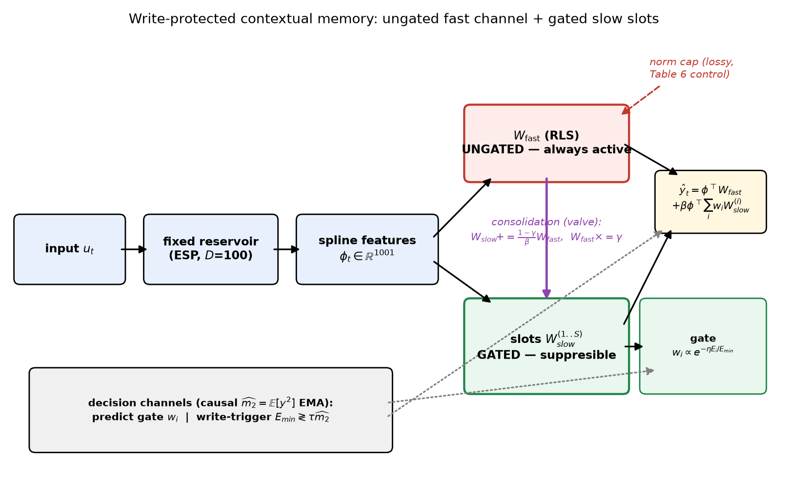
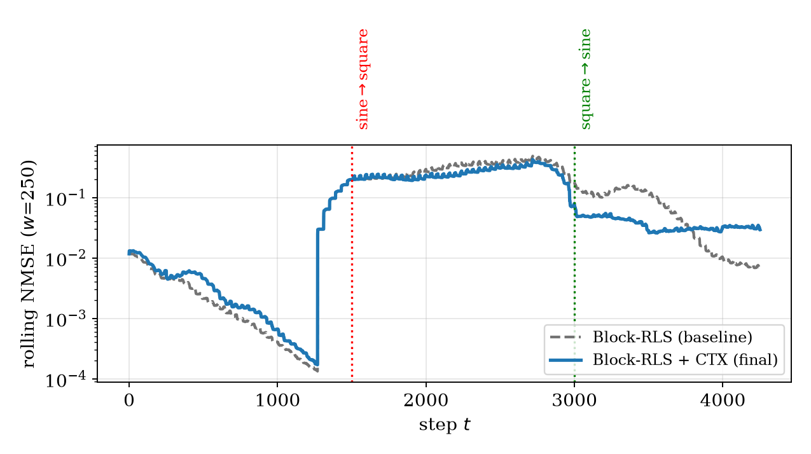
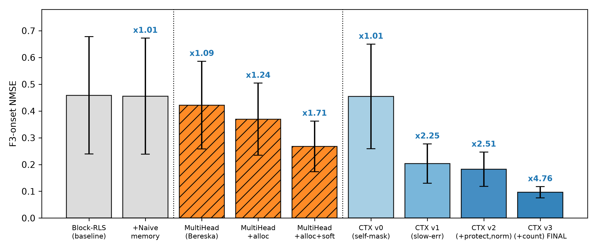
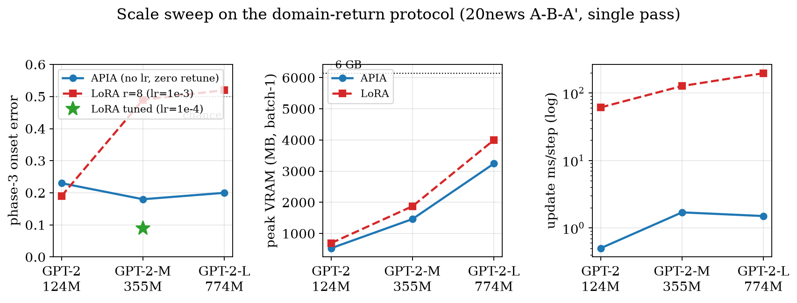
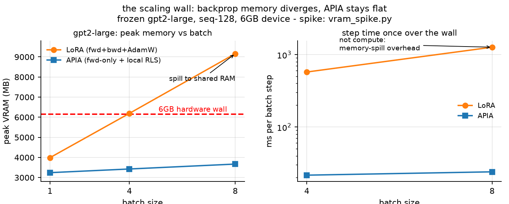

# Write-Protected Contextual Consolidation

Backpropagation-free, fully local, online continual learning for
reservoir-based time-series prediction.

A fixed Echo State Network reservoir (ESP-constrained) feeds a
cubic B-spline feature map and a block-diagonal online RLS readout.
A dual-rate contextual memory — one ungated fast weight channel plus
S gated slow slots — consolidates regime-specific knowledge under
write protection, cutting regime-return onset error ~4.8x versus the
memoryless baseline (10 seeds, sine->square->sine protocol).

All learning is local and online: no backpropagation, no replay
buffer, no offline batch passes. ~130 us/step, ~0.13 MB (float64)
in the pure-NumPy prototype.

Archive DOI: [10.5281/zenodo.24448925](https://doi.org/10.5281/zenodo.24448925)

## Architecture



A fixed ESP-constrained reservoir drives a per-dimension cubic
B-spline expansion. One ungated fast-weight channel always learns;
S gated slow slots consolidate under write protection.

## Headline result



When the stream returns to sine after a square-wave regime, the
contextual memory's onset NMSE is ~4.8x lower than the memoryless
block baseline (0.096 vs 0.459, mean over 10 seeds).



Factorial ablations separate the two mechanisms: stored context
content vs. implicit drainage of the ungated channel. The matched-norm
clamp control recovers only part of the gain — slot content matters.

## Contents

| File | Role |
|---|---|
| `reservoir.py` | ESP-constrained ESN + cubic B-spline feature map |
| `rls_engine.py` | block-diagonal RLS with trace bound |
| `contextual_memory.py` | fast/slow slots, gate, write protection, transfer |
| `memory.py`, `multihead.py` | naive-memory and Bereska-style competitors |
| `continual_protocol.py` | stream builder + main sine->square->sine protocol |
| `benchmark_block_rls.py` | readout characterization (paper Table 1) |
| `different_tasks.py` | cross-family generalization (NARMA/MG-30) |
| `saturation_test.py` | slot-overload policies (overwrite/refuse/clamp) |
| `valve_test.py` | drainage-valve analysis (paper Fig. 6) |
| `clamp_control.py` | matched-norm clamp control (paper Table 7) |
| `make_figures.py`, `fig1_architecture.py`, `fig2_windup.py` | figures + `metrics.json`/`fig_data.npz` |
| `make_tables.py` | generated tables (`gen/`) + `numbers_macros.tex` |
| `audit_numbers.py` | 24-assert data audit: every claim vs data files |
| `build_tex.py`, `lint_tex.py`, `lint_pdf.py` | md->tex build + render lint |
| `metrics.json`, `fig_data.npz`, `saturation_data.npz`, `valve_data.npz`, `clamp_control.json` | measured data (single source of truth) |
| `llm_spike.py`, `cls_spike.py`, `adapter_spike.py`, `scale_spike.py` | Phase-2 feasibility spikes: same mechanism on frozen GPT-2 features — time-series, domain-return classification, APIA-vs-LoRA head-to-head, 124M->774M scale sweep. Not part of the paper's protocol — seeds for a follow-up study |
| `vram_spike.py` | Phase-2: gpt2-large batch sweep — APIA fwd-only vs LoRA fwd+bwd+AdamW peak VRAM (`vram_scaling` key) |
| `fig_phase2_scale.py`, `fig_vram_wall.py` | README figure generators (data from `spike_results.json`) |
| `spike_results.json` | Phase-2 spike measurements (P3 errors, VRAM, ms/step, lr-sweep, vram_scaling) |

## Reproduce

```bash
pip install -r requirements.txt   # Python 3.13, NumPy 2.5.2
python make_figures.py            # main protocol, 10 seeds -> metrics.json
python different_tasks.py         # cross-family, 5 seeds
python saturation_test.py         # -> saturation_data.npz
python valve_test.py              # -> valve_data.npz
python clamp_control.py           # -> clamp_control.json
python audit_numbers.py           # 24 asserts vs data
python make_tables.py             # gen/table*.tex + numbers_macros.tex
python build_tex.py               # paper.tex (needs pandoc)
python lint_pdf.py                # render-level checks (needs tectonic+pdftotext)
```

Every run uses `np.random.default_rng(seed)` — seeds 0-9 (main),
0-4 (cross-family). Results are bit-reproducible.

## Phase-2 spikes (preliminary, not part of the paper)

Same mechanism mounted on frozen GPT-2 features, tested against
online LoRA on a domain-return classification stream
(`spike_results.json` for all numbers):



The honest finding is not "APIA is more accurate" — tuned LoRA wins
on accuracy (0.09 vs 0.18 onset). It is that APIA needs **no learning
rate at all** and stays flat (0.18-0.24) from 124M to 774M while the
same LoRA config collapses; updates cost ~1 ms regardless of model
size vs 61-196 ms. See `llm_spike.py`, `cls_spike.py`,
`adapter_spike.py`, `scale_spike.py`.

### The scaling wall (measured on a 6GB device)

Same protocol on frozen `gpt2-large`, seq-128, batch sweep 1→8
(`vram_spike.py`, `spike_results.json[vram_scaling]`):



| batch | APIA peak | LoRA peak |
|---|---|---|
| 1 | 3,243 MB | 3,989 MB |
| 4 | 3,425 MB | **6,191 MB** |
| 8 | 3,670 MB | **9,159 MB** |

Batch 1→8: APIA grows +427 MB (transient forward activations only —
`no_grad`, nothing retained for backward). LoRA grows +5,170 MB
(retained activations + grads + AdamW state) and exceeds the 6GB
physical wall already at batch 4 — beyond it, Windows spills ~4 GB
into shared RAM and step time balloons (575→1,267 ms, spill overhead
not compute). **APIA's learning-state cost scales with the feature
dimension (~400 KB), not the model — the structural reason a frozen
100B backbone could adapt in a fixed memory budget.** Timing scopes
differ (APIA update is feature-space RLS; LoRA is full fwd+bwd+opt),
so the speed gap is a lower bound, not a headline.

## Paper

`paper_draft.md` -> `paper.tex` -> `paper.pdf` (19 pp).
